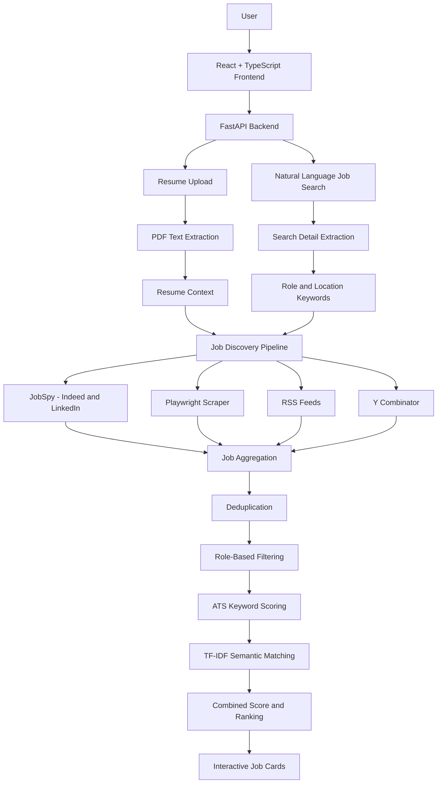

# 🎯 Job Hunt AI – Resume-Powered Job Discovery Platform

A resume-powered job discovery and matching platform that searches multiple job sources, filters relevant opportunities, and ranks job listings based on a candidate's skills and resume compatibility.

Upload your resume, enter a natural-language job search request, and discover opportunities ranked using ATS keyword matching and semantic similarity.


---

## 🌐 Live Application

| Component | Link |
|---|---|
| Live Application | https://job-hunt-agent-1.onrender.com |
| Backend API | https://job-hunt-agent-fl5z.onrender.com |
| API Documentation | https://job-hunt-agent-fl5z.onrender.com/docs |
| Backend Health Check | https://job-hunt-agent-fl5z.onrender.com/health |
| GitHub Repository | https://github.com/Kirankavala143/job-hunt-agent |

**Deployment:** The React frontend and FastAPI backend are currently deployed as separate Render services. The frontend communicates with the backend through its API.

**Note:** Render's free services can spin down after inactivity, so the first request may take longer while the service starts.

---

## 📸 Application Preview


## ✨ Key Features

- **Resume Upload:** Upload PDF resumes and extract text for matching.
- **Multi-Source Job Discovery:** Collect opportunities from Indeed, LinkedIn, RSS feeds, and Y Combinator job sources.
- **Natural-Language Search:** Enter requests such as "Find React Developer Intern jobs in India".
- **Role-Based Filtering:** Identify relevant job titles and exclude unrelated or senior positions.
- **ATS Scoring:** Compare skills extracted from the resume against job descriptions.
- **Semantic Matching:** Use TF-IDF and cosine similarity to estimate textual relevance.
- **Combined Ranking:** Rank jobs using ATS and semantic scores.
- **Interactive Dashboard:** Filter by source, adjust score thresholds, sort results, and access job application links.

## 🏗️ System Architecture



## 🧠 How the Application Works

1. **Resume Upload:** The user uploads a PDF resume. The FastAPI backend extracts its text and keeps it available for job matching.
2. **Search Processing:** Python extracts relevant job categories, titles and locations from the user's search request.
3. **Job Discovery:** Multiple scrapers collect job listings concurrently from supported sources.
4. **Deduplication:** Duplicate listings are removed using job title and company information.
5. **Job Filtering:** The filtering engine checks role relevance, experience requirements, seniority and location.
6. **ATS Scoring:** The application calculates keyword coverage between resume skills and job descriptions.
7. **Semantic Matching:** TF-IDF and cosine similarity estimate textual similarity between the resume and job descriptions.
8. **Ranking:** Results are ranked using a combined score and returned to the React dashboard.

## 📊 Resume Matching Methodology

The application uses three scoring values.

**1. ATS Score**

Measures how many skills identified in the resume are also found in the job description.

**2. Semantic Score**

Uses TF-IDF vectorization and cosine similarity to estimate textual relevance between the resume and job description.

**3. Combined Score**

The current scoring implementation uses:

`Combined Score = (ATS Score × 0.70) + (Semantic Score × 0.30)`

These scores are approximate matching indicators, not guarantees of employer ATS results or interview selection.

## 🛠️ Technology Stack

| Layer | Technologies |
|---|---|
| Frontend | React, TypeScript, Vite |
| Backend | Python, FastAPI, Uvicorn |
| Job Scraping | JobSpy, Playwright, BeautifulSoup |
| Job Sources | Indeed, LinkedIn, RSS, Y Combinator |
| Resume Processing | PDF text extraction |
| ATS Matching | Python, keyword matching |
| Semantic Matching | scikit-learn, TF-IDF, cosine similarity |
| Version Control | Git, GitHub |
| Deployment | Render |

## 📁 Project Structure

```text
job-hunt-agent/
│
├── backend/
│   ├── main.py
│   ├── agent.py
│   ├── crew_agency.py
│   ├── scraper.py
│   ├── job_filter.py
│   ├── ats_scorer.py
│   ├── mcp_export.py
│   └── requirements.txt
│
├── frontend/
│   ├── src/
│   ├── public/
│   ├── package.json
│   ├── package-lock.json
│   └── vite.config.ts
│
├── searxng/
├── searxng_config/
├── .gitignore
└── README.md
```

## 🚀 Getting Started

### Prerequisites

- Python 3.12+
- Node.js and npm
- Git
- Chromium browser for Playwright

### 1. Clone the repository

```bash
git clone https://github.com/Kirankavala143/job-hunt-agent.git
cd job-hunt-agent
```

### 2. Backend Setup

```bash
cd backend
python -m venv venv
```

Activate the environment on Windows:

```cmd
venv\Scripts\activate
```

Install dependencies:

```bash
pip install -r requirements.txt
playwright install chromium
```

Start the backend:

```bash
uvicorn main:app --reload
```

Backend URL:

`http://localhost:8000`

API documentation:

`http://localhost:8000/docs`

### 3. Frontend Setup

Open a new terminal from the project root:

```bash
cd frontend
npm install
```

Create a local `.env` file inside the frontend directory:

```env
VITE_API_BASE_URL=http://127.0.0.1:8000
```

Start the frontend:

```bash
npm run dev
```

Frontend URL:

`http://localhost:5173`

## ☁️ Deployment on Render

The application is deployed using two Render services connected to the same GitHub repository.

### Backend – Render Web Service

| Setting | Value |
|---|---|
| Runtime | Python 3 |
| Root Directory | `backend` |
| Build Command | `pip install -r requirements.txt` |
| Start Command | `uvicorn main:app --host 0.0.0.0 --port $PORT` |

Backend:

https://job-hunt-agent-fl5z.onrender.com

### Frontend – Render Static Site

The frontend is deployed separately as a Render Static Site.

The deployed frontend communicates with the backend API.

Frontend:

https://job-hunt-agent-1.onrender.com

The backend CORS configuration must allow the deployed frontend origin.

## 🔌 API Endpoints

| Method | Endpoint | Description |
|---|---|---|
| GET | `/` | Backend root endpoint |
| GET | `/health` | Backend health check |
| POST | `/api/upload_resume` | Upload and extract resume text |
| POST | `/api/chat` | Search for relevant job opportunities |

API documentation:

https://job-hunt-agent-fl5z.onrender.com/docs

## ⚠️ Limitations

- Job availability depends on external job sources.
- Scrapers may return incomplete results or experience rate limits.
- Some job descriptions may not be publicly accessible.
- ATS and semantic scores are estimates, not official employer scores.
- Resume context is currently maintained in backend memory and is not a persistent multi-user storage system.
- Free hosting services may experience cold starts after inactivity.

## 🚀 Future Development Roadmap

The project is currently in its beta stage. The following improvements are planned to make it a more complete, reliable and intelligent job-search platform.

### Phase 1 – Deployment and Reliability

- Improve scraper error handling, retries and rate-limit management.
- Add more robust application health checks and structured logging.
- Improve production monitoring and service reliability.

### Phase 2 – Advanced AI-Powered Matching

- Improve semantic matching using sentence-transformer embeddings.
- Introduce contextual resume-to-job compatibility analysis.
- Generate personalized skill-gap reports for each job.
- Provide suggestions for improving resumes based on job descriptions.
- Explore optional LLM-powered job recommendations.

### Phase 3 – Personalized Job Management

- Implement user registration and authentication.
- Add persistent user profiles and resume storage.
- Allow users to save, bookmark and track job applications.
- Build an application status tracker with stages such as Applied, Interview, Rejected and Selected.
- Maintain individual job-search history and preferences.

### Phase 4 – Automated Job Discovery

- Integrate additional job sources and company career portals.
- Implement scheduled job discovery and personalized email notifications.
- Detect duplicate listings across multiple job platforms.
- Identify expired or potentially inactive job postings.
- Add location, salary, experience and employment-type filters.

### Phase 5 – Analytics and Career Insights

- Build a personalized job-search analytics dashboard.
- Track ATS compatibility trends across applications.
- Identify frequently requested skills in target job categories.
- Recommend learning resources based on identified skill gaps.
- Generate personalized career-development insights.

### Long-Term Vision

Build a comprehensive AI-powered career assistant that helps job seekers discover opportunities, understand their market readiness, improve their resumes and manage their entire job application journey from one platform.

*Note: These are planned enhancements and are not currently available in the beta application.*

## 🙏 Acknowledgments

This project was developed by extending and customizing an existing educational job-search project. The original developer granted permission for reuse and modification. Additional work includes job filtering, resume scoring, scraper integration and frontend-backend improvements.

## 👨‍💻 Author

**Kiran Kavala**

GitHub: [Kirankavala143](https://github.com/Kirankavala143)

Project: [Job Hunt AI](https://github.com/Kirankavala143/job-hunt-agent)
